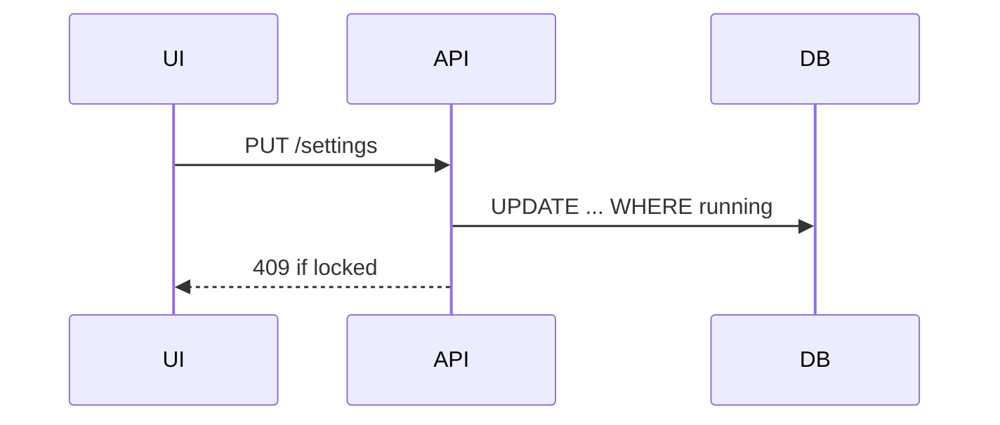

# Show me

Goal: the reader understands the idea of a change in about two minutes and can give design feedback before reading any code. A picture replaces each paragraph it can. This is not a code review: report no line-level findings or style nits. A likely bug becomes a question under feedback.

Visual vocabulary adapted from humanlayer's `show-me` skill (MIT). HTML pages render through the [archify](https://github.com/tt-a1i/archify) skill.

`ARCHIFY` below means the archify skill folder. Find it once per run with `ls -d ~/.claude/skills/archify ~/.agents/skills/archify 2>/dev/null | head -1`, falling back to `find ~/.claude ~/.agents -path '*archify/bin/archify.mjs' 2>/dev/null | head -1`. When archify is missing, use screen mode and tell the user that `npx skills add tt-a1i/archify` enables the HTML page.

## 1. Resolve the subject

| Argument | Gather |
|---|---|
| PR number or URL | `gh pr view <n> --repo <owner/repo> --json number,title,body,author,url,baseRefName,headRefName,headRefOid,files,additions,deletions,commits` and `gh pr diff <n> --repo <owner/repo>`. A bare number means the current repo. |
| Branch, or no argument with local commits | `git diff $(git merge-base origin/main HEAD)...HEAD`, `git log --oneline origin/main..HEAD`, plus uncommitted changes. |
| Plan, spec, ticket, doc or file | Read it. Then read the code it would change, so the "before" is real and not guessed. |
| Nothing at all | The current topic of conversation. |

Read in this order: the description and any linked ticket (the author's intent frames everything), then the diff, then the surrounding code at the head commit only where the diff hides the shape: callers, the function a hunk sits in, the type a field joins. In a local clone of the PR's repo, `git fetch origin <headRefOid>` once, then use `git show "${sha}:path"` and `git grep -n <pattern> "${sha}" -- <paths>`. Brace the variable: in zsh, `$sha:u…` reads as a modifier and silently breaks the path.

When the description already lists open questions or a deploy plan, use them: credit them to the author and add only what they miss. Skip generated output (`*.gen.*`, `*.pb.go`, mocks, lockfiles, snapshots, vendored code) except to note that it changed.

## 2. Build the model before drawing

Answer these in your own notes. Skip any that do not apply; never pad.

1. **Problem.** What was wrong or missing, in one sentence.
2. **Idea.** The approach, in one sentence.
3. **Before and after.** Which flow, structure or state changes, and the smallest picture that shows the difference.
4. **Entry point.** Where the new behaviour starts: a route, job, handler, queue consumer, UI action or CLI command.
5. **Data and state.** New tables, columns, flags, config, stored shapes, migrations or backfills.
6. **Reach.** Other callers of the changed code, deploy order, flag gating, backwards compatibility.
7. **Decisions.** Choices where a reasonable reviewer might pick differently, and the alternative.
8. **Open questions.** What the change does not say: an unhandled case, a missing test, a rollout gap.

Every claim comes from the diff, the description or code you read; cite `path:line`. Label an inference as one.

## 3. Pick the output

- An explicit `screen` or `html` argument wins.
- Otherwise choose `screen` when the change is one idea that fits on one screen (roughly five meaningful files or fewer), and `html` when it has several flows, a data model, a rollout order, or more files than that.
- State the mode chosen in one line and that the other is available.

## 4a. Screen

Lead with the result. Keep every text line short; place each visual right after the one or two lines it supports.

```text
**<title>**: <the idea in one line>
Why: <the problem in one line>

<2–4 visuals>

Worth your feedback
- <decision or question> (path:line)

Not shown: <tests, generated files, areas skipped>
```

Pick the smallest view that makes each point. Prefer a `diff` shape when the point is what changes and the surrounding shape already exists; show the whole block when most of it is new or omitted context would hide order or ownership.

Logic as pseudocode:

```text
on(save)
  if content is unchanged
    return cached result
  write new content
```

Runtime control flow as a call-tree diff:

```diff
 submitForm
   createSession
     persistPrompt
+    expandSkillMention
     launchAgent
```

File responsibility as a shallow file-tree diff, one comment per line:

```diff
 src/
 ├── commands/
+│   └── show-me.ts       # expands the slash command
-└── transport.ts
+└── transport/
+    ├── client.ts
+    └── stream.ts
```

UI structure as a component tree with the state and module boundaries that matter:

```diff
 <SessionPage> (apps/web/src/routes/session.tsx)
   useSessionEvents()
   <SessionToolbar>
+    <RunSkillButton />
```

State or control flow as a diff:

```diff
 on(save)
-  write content
+  if content is unchanged
+    return cached result
+  write new content
+  invalidate cache
```

Interaction between parts, or a branching process, as Mermaid:



A data-shape change as a before/after table of fields, or a `diff` of the struct or schema.

Use one, several, rarely all. Keep only the calls, files, fields and states needed to understand the change.

## 4b. HTML page

The page is an Archify explainer: the conclusion first, then panels with native diagrams that the reader can explore.

1. Read `ARCHIFY/references/explainer-authoring.md` once. It is the complete draft language; follow its rules for IDs, pipe rows, backticks in prose and diagram limits (four native diagrams per page).
2. Make a folder `~/.show-me/<YYYYMMDD-HHMMSS>-<slug>/` (local time; slug from the PR number or topic, such as `services-35713`) and write `candidate.archify.md` there from [the page template](references/page-template.md).
3. Deliver:

   ```bash
   node ARCHIFY/bin/archify.mjs finalize explainer <folder>/candidate.archify.md <folder>/<slug>.html --json
   ```

   A non-zero exit is a failure. The message names the line, the component and a repair; fix the draft and rerun to the same output path. Fix writing warnings when the repair keeps the meaning.
4. Open it: `open <folder>/<slug>.html`.
5. Reply in two or three lines: the idea of the change, then a Markdown link to the page with a descriptive title and its absolute path. Add the archify update notice only when the receipt's `update.noticeRequired` is true. Skip archify's proactive-mode offer.

## Guardrails

- Use the codebase's own names for things across text, diagram labels and tables.
- One idea per visual. A section with nothing to say is left out, not filled.
- When the subject is too large for one view (more than about four separate flows), show the main flow and list the others under "Not shown" or as a table of the remaining areas.
- Never post anything to the PR, ticket or doc. The output is for the reader only.
